

  

<h1 align="center">🌸 Miyorare 🌸</h1>

  <b>A cozy spot for your manga, novels, and everything you love reading.</b>

  Read • Save • Come back for one more chapter ✨

  
  
  

  <a href="https://github.com/Noirero/Miyorare/releases/latest"><strong>📦 Download Miyorare</strong></a>
  ·
  <a href="https://github.com/Noirero/Miyorare/issues"><strong>🐛 Report a Bug</strong></a>
  ·
  <a href="SECURITY.md"><strong>🛡️ Security</strong></a>

---

> 🌸 **Hey, welcome to Miyorare!**
>
> It's an Android reader for manga and novels. Open one chapter, and somehow it's already three in the morning. 📖☕

## ✨ What can you do with Miyorare?

- 📚 Keep your **manga and novels** together in one reader.
- 🌐 Discover stories through **official Miyorare Source Packs** and compatible third-party sources, extensions, and plugins.
- 💾 Download chapters to read offline when the source supports it.
- ❤️ Organize Favourites with categories, bookmarks, history, chapter ratings, and Personal Notes.
- 🧭 Get the cover, reading progress, status, and other useful details in one place.
- 🗂️ Search, sort, and group chapters, with extra chapter information when you need it.
- 📅 Check next-chapter predictions and a release calendar where enough data is available.
- 📦 Read your own **CBZ, ZIP, EPUB, and PDF** files.
- 🔄 Back up and restore your reading data.
- 🎨 Make it feel like yours with light/dark modes, accent colors, and custom backgrounds.

## 🌐 Miyorare Source Packs

Miyorare's official Source Packs are maintained separately from the app, so sources can be updated without waiting for another APK release.

There are currently two collections:

- 🇮🇩 **Miyorare-ID** — Indonesian-language sources.
- 🇬🇧 **Miyorare-EN** — English-language sources.

The packs bring together curated and adapted sources from compatible ecosystems, including **Keiyoushi, UMA, and Gekkoushi**, with adjustments for Miyorare.

➡️ **[Browse Miyorare Source Packs](https://github.com/Noirero/Miyorare-Source-Packs)**

“Official” means Miyorare curates, builds, checks, and distributes the pack. It doesn't mean the project owns the websites, content, services, or all of the upstream code behind those sources.

## 🔌 Where do sources come from?

Miyorare supports several source and extension ecosystems, including:

- **[Kotatsu](https://github.com/KotatsuApp/Kotatsu)** — parsers and sources.
- **[Mihon](https://github.com/mihonapp/mihon)** — extensions.
- **[Keiyoushi](https://github.com/keiyoushi/extensions-source)** — sources, extensions, and references.
- **[UMA](https://github.com/InvalidDavid/UMA)** — plugins and sources.
- **[Gekkoushi](https://github.com/Gekkoushi/plugin-source)** — plugins and sources.
- **[Miyorare Source Packs](https://github.com/Noirero/Miyorare-Source-Packs)** — sources curated for Miyorare.

Actual compatibility depends on the source or plugin, the website it connects to, and the versions involved.

Kotatsu, Mihon, Keiyoushi, UMA, and Gekkoushi are independent projects. Miyorare isn't affiliated with or endorsed by them, and isn't responsible for content served through third-party sources.

## 📱 A Look Around

Open any section to see the app in action. These screenshots come from the stable version; beta screens may look a little different.

<strong>❤️ Favourites & Personalization</strong>

 

  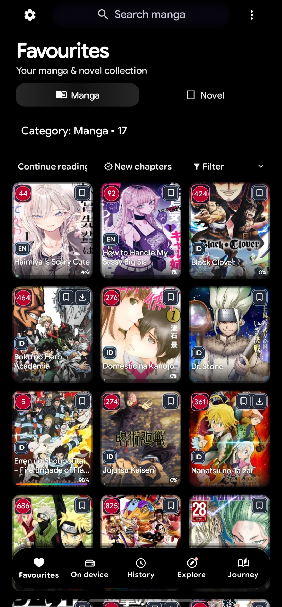
  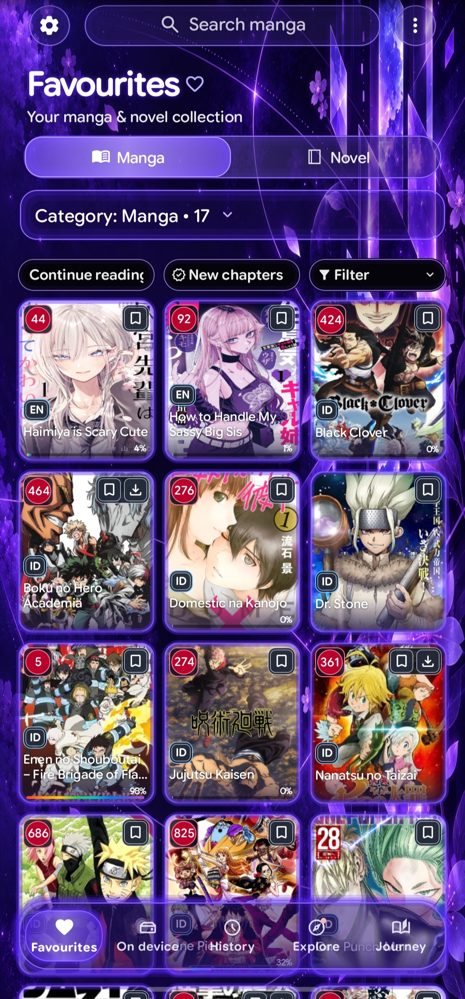
  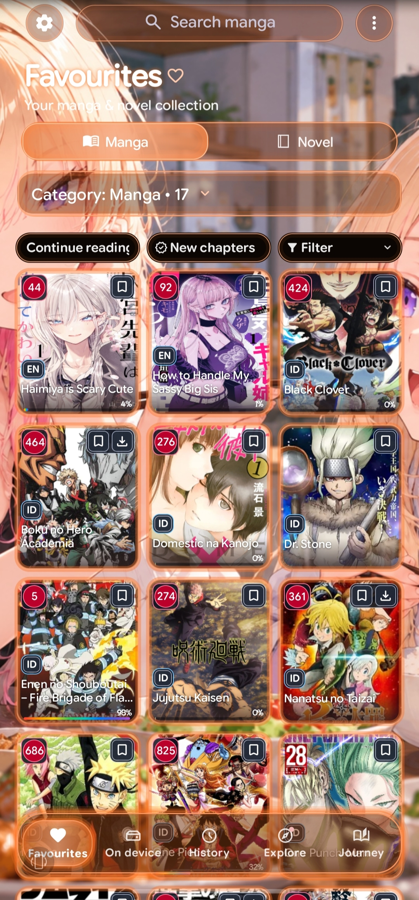
  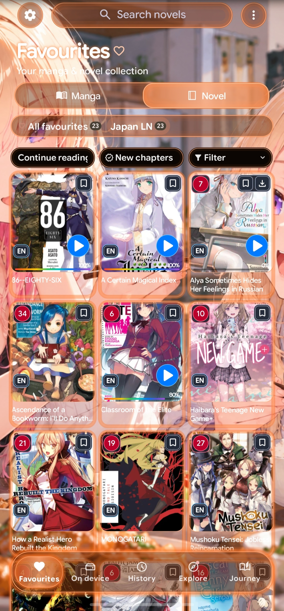

<strong>🔐 Private Favourites</strong>

 

  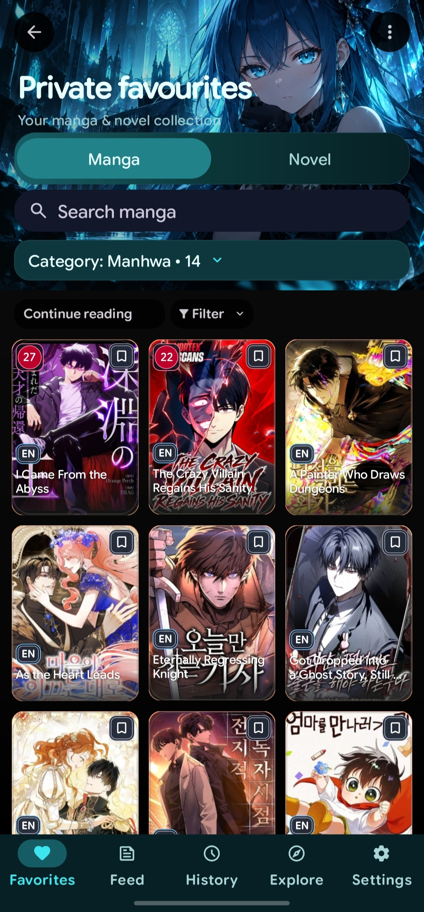
  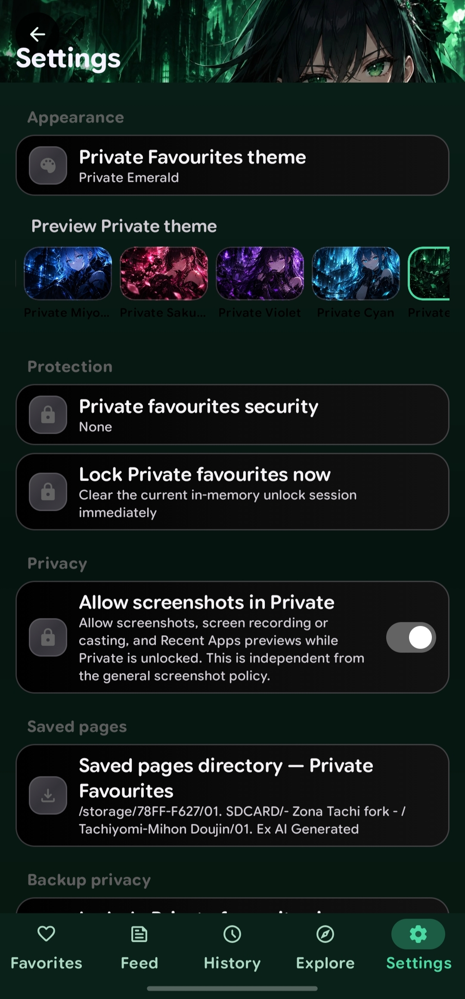

<strong>📚 Manga Details & Chapter Intelligence</strong>

 

  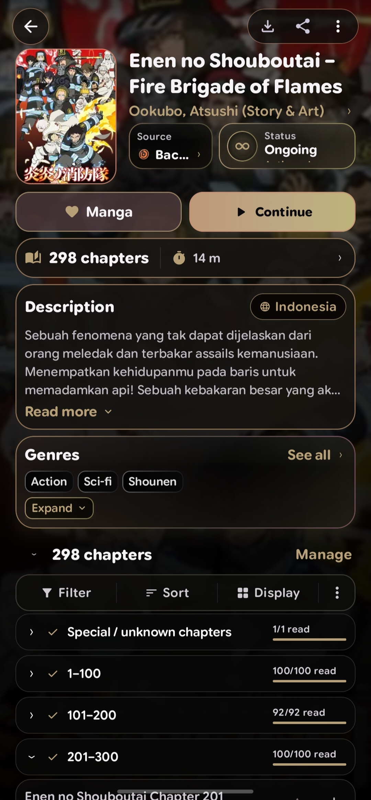
  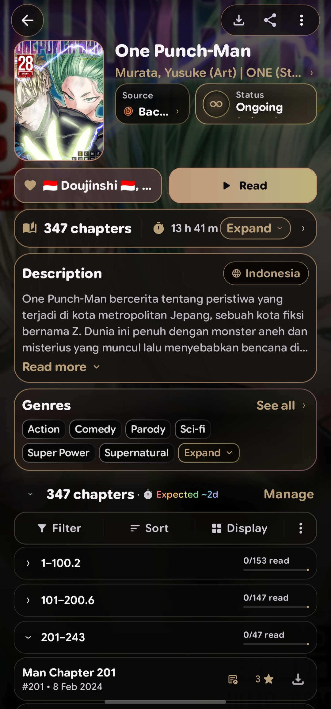
  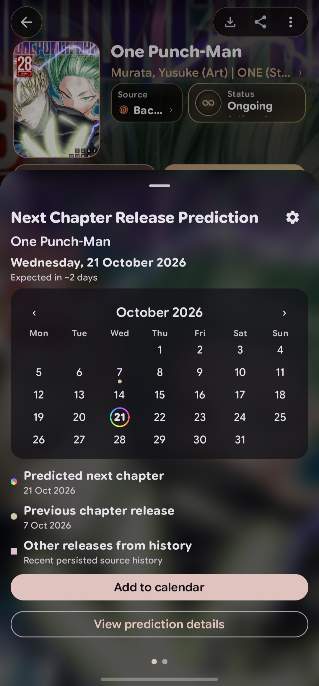

<strong>📥 On-device Library</strong>

 

  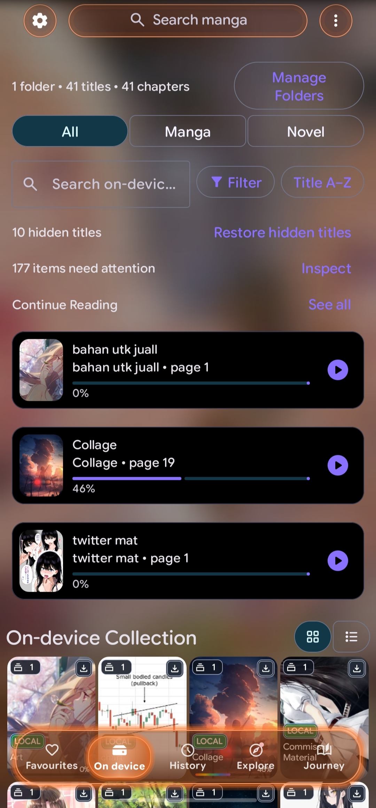

<strong>🧭 Explore & Sources</strong>

 

  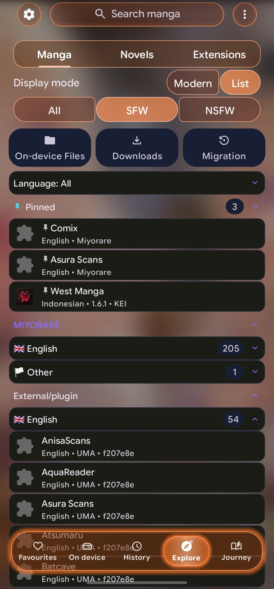

<strong>📖 Reading Experience</strong>

 

  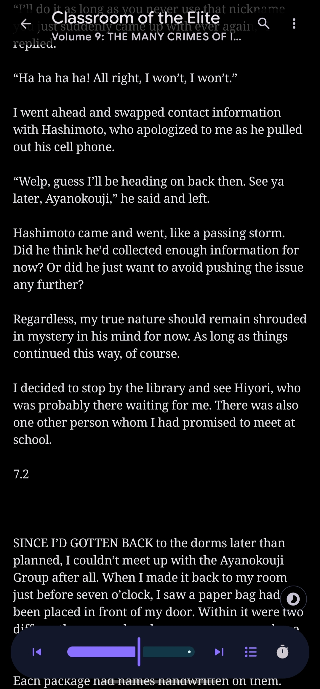
  

## 📦 Getting Started

1. Head to [Miyorare's GitHub Releases](https://github.com/Noirero/Miyorare/releases/latest).
2. Download the latest stable APK.
3. Install it on your Android device.
4. Add a Source Pack, source, or extension you trust.
5. Pick something good to read. ✨

Because Miyorare is distributed outside the Play Store, Android may ask you to allow installs from your browser or file manager.

### Main or Beta?

| Channel | What it's for | Application ID |
| --- | --- | --- |
| `main` | Stable builds for everyday use | `org.noirero.miyorare` |
| `beta` | Testing newer changes | `org.noirero.miyorare.beta` |

You can install both side by side: they use different application IDs. The download link above points to the stable release, not necessarily a beta build.

## 🛡️ Security & Play Protect

A Play Protect warning is worth looking into, but it **doesn't automatically mean Miyorare is malware**. Features such as extension APK installation, storage access, installed-app inspection, and Shizuku support can be treated as sensitive by Android.

Get official stable APKs only from **[Noirero/Miyorare Releases](https://github.com/Noirero/Miyorare/releases)**, and be careful about the sources and extensions you install. The safety of a third-party website or plugin is a separate question from the safety of the reader itself.

Official Source Packs are curated and verified before distribution, but that isn't a guarantee about every external service they connect to. Read **[SECURITY.md](SECURITY.md)** for the trust model, limitations, and more detail.

## 🔐 Stable Release Record

This verification record comes from the `main` README snapshot used for this page. **It's not a live latest-release indicator**; check [GitHub Releases](https://github.com/Noirero/Miyorare/releases/latest) for the newest stable version.

<!-- RELEASE_README_START -->
- **Version:** [v1.4.10](https://github.com/Noirero/Miyorare/releases/tag/v1.4.10)
- **Commit:** [`d55c6cb4a933959542d0a4b4384ec9ec368b2dad`](https://github.com/Noirero/Miyorare/commit/d55c6cb4a933959542d0a4b4384ec9ec368b2dad)
- **GitHub Actions:** [run 38783075931](https://github.com/Noirero/Miyorare/actions/runs/38783075931)
- **APK and SHA-256:**
  - `Miyorare-v1.4.10.apk` — `10ca955a6b1dd4e37a008c0332da929ded1b321fe85ab6ff4c96534121e0b08d`
<!-- RELEASE_README_END -->

You can find signing and security information in [SECURITY.md](SECURITY.md). The release markers are kept intact for the project's tooling.

## ☕ Found Something Odd?

Miyorare is still growing, and occasionally a button decides it needs coffee before it'll behave. 🐛☕

If something goes wrong, open a [GitHub Issue](https://github.com/Noirero/Miyorare/issues). A screenshot, screen recording, or a few steps to reproduce it help a lot.

## 💖 Credits

Miyorare started from the [DropSauce](https://github.com/HuzaifaKhalid1311/DropSauce) codebase and grew into its own independently maintained project. DropSauce is acknowledged as **historical origin**, not a live upstream: Miyorare doesn't automatically follow or merge DropSauce changes.

A lot of open-source work helped make this possible. Thanks to the people behind:

- [DropSauce](https://github.com/HuzaifaKhalid1311/DropSauce) — original codebase, not an active upstream.
- [Kotatsu](https://github.com/KotatsuApp/Kotatsu)
- [Mihon](https://github.com/mihonapp/mihon)
- [Keiyoushi](https://github.com/keiyoushi/extensions-source)
- [UMA](https://github.com/InvalidDavid/UMA)
- [Gekkoushi](https://github.com/Gekkoushi/plugin-source)
- [LNReader](https://github.com/LNReader/lnreader)

And thanks to the developers of the libraries, parsers, extensions, plugins, and other open-source tools used around Miyorare. Upstream-origin work keeps its applicable attribution and license requirements.

## 📜 License

Miyorare is open source under the **GNU GPL**. See [LICENSE](LICENSE) for the full license.

## Disclaimer

Miyorare doesn't include manga or novels of its own, and it isn't affiliated with outside content providers. Adding a source, extension, plugin, library, or Source Pack doesn't mean Miyorare owns or runs the service behind it.

---

  <b>Miyorare 🌸</b> 
  <i>Read what you love. Keep what you love.</i>  
  Made with ☕, Kotlin, and probably one chapter too many.

